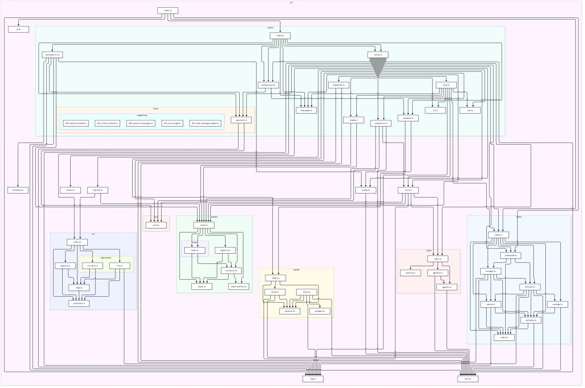

# yog

An agent harness that mounts a virtual FUSE directory and runs a streaming
OpenAI-compatible chat completion with a single tool: `bash`. System features
are presented to agents as proxied virtual file descriptors.

## Server

The harness is a long-lived HTTP/SSE daemon (`src/server/`). It owns every
boundary: the sqlite session store, the worker pool, the session
orchestrator, the OpenAI client/TurnEngine, the FUSE mount, and the
HTTP/SSE adapter. It binds `YOG_HOST:YOG_PORT` (loopback `127.0.0.1:8111`
locally; `0.0.0.0` inside the container).

The daemon is reached through `YOG_SERVER_URL` (default
`http://127.0.0.1:8111`). One-shot client turns are handled by the
[yog-client-tui](https://github.com/haliphax-ai/yog-client-tui)
application, which speaks the v1 HTTP/SSE contract directly.


### Contract endpoints (v1)

| Method | Path | Purpose |
|---|---|---|
| GET | `/v1/capabilities` | Advertise server: contract version, models, tools, `features` (`["sse", "transcript", "abort"]`) |
| POST | `/v1/sessions` | Create a session, optional body `{ title?, system? }` → `{ session: { id, … } }` (201) |
| GET | `/v1/sessions/{id}` | Session status → `{ session }` |
| DELETE | `/v1/sessions/{id}` | **Detach** (advisory, `?purge=true` hard-deletes) → `{ session }` |
| POST | `/v1/sessions/{id}/turns` | Run a turn; streams an SSE transcript (a dormant session is implicitly revived) |
| POST | `/v1/sessions/{id}/abort` | **Abort the current turn**: kill the tool call in flight, close the model stream, heal the transcript |
| GET | `/v1/sessions/{id}/transcript` | **Rehydration dump**: the session's canonical transcript → `{ session, messages }` |
| GET | `/v1/sessions/{id}/turns/{turnId}` | **Turn-status recovery/replay**: fetch terminal turn state when the SSE stream died |

Turn requests are JSON: `{ "prompt": "...", "model": "..." }` (`prompt` is
required; `model` defaults to the server's model). **Clients never send
history** — the server owns the transcript: it hydrates prior context before
each turn and persists everything the turn produced, so a turn request carries
only the new prompt. `POST /v1/sessions` accepts an optional `{ title?,
system? }`; `system` seeds the first transcript message (role `system`) so it
is part of every turn's context.

The SSE stream frames each self-describing envelope
(`{ id, type, version, ts, data }`) as `event:<type>` / `data:<envelope-json>`:

| Event | `data` payload | Meaning |
|---|---|---|
| `turn.started` | `{ turnId, model, ts }` | turn accepted; streaming begins |
| `message.delta` | `{ text }` | assistant text chunk (print as it arrives) |
| `tool.call` | `{ id, name, args }` | model invoked a tool |
| `tool.result` | `{ id, name, ok, result? }` | tool outcome |
| `turn.finished` | `{ turnId, durationMs }` | normal end |
| `turn.aborted` | `{ reason }` | operator aborted the turn; transcript was healed |
| `error` | `{ code, message }` | terminal failure (e.g. `provider_error`) |

**Abort.** `POST /v1/sessions/{id}/abort` ends the session's current turn:

1. The tool call in flight is killed (a running bash script gets SIGTERM; the
   shell-state snapshot still lands via the wrapper's EXIT trap, so cwd/env
   persist).
2. The model stream is closed and the turn unwinds.
3. Any tool call the model announced but that never produced a result is
   healed in the transcript with a stub `tool` message
   (`{"error": "tool call aborted before a result was produced"}`) — the
   next turn hydrates a complete conversation and can be resumed.
4. The turn row is settled with status `aborted`, and the SSE stream frames
   the terminal `turn.aborted` event.

Response: `{ ok, status, session: { id }, aborted: { requested, status,
activeToolCall } }` — `status` is `aborted` when a live turn was unwound and
`idle` when the session had nothing to abort (still `ok: true`, idempotent).
`aborted.activeToolCall` names the tool call that was killed, if any.
Aborts are session-scoped: other sessions' turns are untouched. Abort is a
capability: `GET /v1/capabilities` advertises it under `features`.

**Deltas are disposable; terminal states are authoritative.** If the SSE
connection dies mid-turn, the client reads the `turnId` from `turn.started`
and recovers the terminal state from
`GET /v1/sessions/{id}/turns/{turnId}` — the recovery endpoint returns the
turn with its stored events, or a 404 `{ error: { code, message } }`
envelope for an unknown session/turn.

### Transcripts, resume, and session dormancy

`GET /v1/sessions/{id}/transcript` is the rehydration dump: it returns
`{ session, messages }` where each message is
`{ seq, turnId, ts, role, content, toolCallId?, name?, toolCalls? }` —
monotonic `seq` per session, in conversation order. It accepts
`?after=<seq>&limit=<n>` pagination for clients holding partial state, and it
serves dormant sessions too: dormancy never blocks reads.

There is no terminal "closed" state short of retention. `DELETE
/v1/sessions/{id}` **detaches**: status `open` → `dormant`, `detached_at`
stamped, nothing forfeited (transcript, turns, events all stay), idempotent.
A turn on a dormant session implicitly **revives** it — status back to
`open`, `detached_at` cleared, retention clock reset; there is no reopen
endpoint, reusing the id *is* the reopen. A pruned session is the only truly
terminal state: `?purge=true` deletes immediately, and dormant sessions past
the 30-day retention window are pruned at daemon startup, both followed by
404 `unknown_session` everywhere.

Errors are `{ error: { code, message } }` JSON with a stable code→status
mapping: `invalid_request`/`unknown_model` → 400, `unauthorized` → 401,
`unknown_session` → 404, `rate_limited` → 429, `internal` → 500,
`provider_error` → 502 (no `session_closed` — dormancy never rejects a
turn or a read). Set `YOG_API_TOKEN` on the daemon
to require `Authorization: Bearer <token>` (the client forwards it).

`test/conformance.test.ts` (and its transcript extension,
`test/conformance.transcript.test.ts`) boots an ephemeral daemon and
exercises this contract exactly like an external client (plain `fetch`):
capabilities, session lifecycle, a full SSE turn transcript, server-owned
transcripts (multi-turn hydration, resume, dormancy, purge, pagination),
turn-status recovery, and the error-code mapping.

## Usage

```sh
yog serve [--host <addr>] [--port <n>]   # start the HTTP/SSE daemon
```

(or via npm: `npm run start:serve`.)

- `serve` logs the listening URL and runs until SIGINT/SIGTERM (graceful
  shutdown: HTTP → worker pool → store → unmount).
- One-shot client turns are handled by the
  [yog-client-tui](https://github.com/haliphax-ai/yog-client-tui)
  application, which speaks the v1 HTTP/SSE contract directly.
- Uses `OPENAI_BASE_URL` / `OPENAI_API_KEY` when set (compatible-proxy
  support), otherwise the SDK defaults.
- Runs the `bash` tool through a dedicated worker process; the persistent
  shell state is mirrored into the agentfs database (see below).

## Environment variables

| Variable | Default | Purpose |
|---|---|---|
| `YOG_HOST` | `127.0.0.1` (`0.0.0.0` in the container) | daemon bind address (`yog serve`) |
| `YOG_PORT` | `8111` | daemon port; also the port compose publishes to the host |
| `YOG_SERVER_URL` | `http://127.0.0.1:8111` | client: daemon origin for the yog-client-tui app |
| `YOG_WORKERS` | `max(1, cpus - 1)` | daemon: worker pool size for parallel tool execution |
| `YOG_STATE_ROOT` | `/var/lib/yog` | daemon: state root (`sessions.db`, `agentfs/<agentId>.db`) |
| `YOG_STATE_PATH` | *(derived from root)* | full-path override for the agent state db |
| `YOG_STATE_DB` | `.agentfs/yog.db` | legacy agentfs db path override |
| `YOG_API_TOKEN` | *(unset)* | require/forward `Authorization: Bearer …` on the contract |
| `YOG_DB_SLOW_MS` | `50` | daemon: log a warning with SQL + timing when a store query exceeds this (log-only tripwire) |
| `YOG_MODEL` / `OPENAI_MODEL` | `gpt-4o-mini` | model id advertised by capabilities and used for turns |
| `OPENAI_BASE_URL` / `OPENAI_API_KEY` | *(SDK defaults)* | provider endpoint + key |
| `YOG_MOUNT` | `/yog` | FUSE mountpoint |

### Docker

Build the image and run the daemon through Docker Compose. The compose
manifest starts the daemon container (entrypoint runs `yog serve` with
`YOG_HOST=0.0.0.0`), publishes `YOG_PORT` to the host, and waits for
`/v1/capabilities` to answer before accepting turns:

```sh
docker compose up -d --build
# then point any client at it:
docker compose exec yog yog serve --help
```

Customize the base image and runtime with override files:

- `docker-compose.override.yml` — layer additional services, volume mounts,
  environment variables, or port mappings on top of the base manifest.
- `Dockerfile.local` — build a custom image variant (e.g. different base
  node version, extra packages) and reference it from the override via
  `build: { context: ., dockerfile: Dockerfile.local }`.

The daemon's state databases live under `/var/lib/yog` (`YOG_STATE_ROOT`):
`sessions.db` (sessions/turns/events) and `agentfs/<agentId>.db` (audit +
shell state). Mount that path from the host so state persists across runs
and turso/libsql's file locking works (it misbehaves on Docker's overlay
filesystem).

## Layout

<details><summary>Files</summary><br />

- `cli.ts` - CLI arg parsing: `serve` subcommand with `--host`/`--port` flags.
- `index.ts` - CLI entry: dispatches `serve` (daemon).
  - `server/`
    - `serve.ts` - composition root for the daemon (`createDaemon`).
    - `http.ts` - v1 HTTP/SSE adapter (routes, validation, error mapping).
    - `sse.ts` - SSE framing helpers (server side).
    - `orchestrator.ts` - parallel sessions, FIFO turns per session, turn abort.
    - `workpool.ts` - worker pool (`YOG_WORKERS`).
    - `store/sessions.ts` - sqlite session/turn/event store (better-sqlite3).
  - `turn.ts` - agent turn engine: streams completions, executes tool calls,
    feeds results back until the model answers without tools.
  - `mount.ts` — mount/unmount helpers (accepts any `FuseOps`).
  - `host.ts` - host proxy: the only sanctioned path for descriptors
    and tools to touch the host - filesystem **and** subprocess spawning
    (direct `node:fs` / `node:child_process` imports elsewhere are blocked by
    dependency-cruiser).
  - `fuse-native.d.ts` - ambient typings for the untyped `fuse-native` package.
  - `vfs/`
    - `index.ts` — shared descriptor-tool plumbing: `DescriptorFile`
      interface + `DescriptorRegistry` (open/create fd handling, write
      buffering, commit-on-release, truncate, unlink denial, errno
      constants). Registry paths are assigned at registration time, not
      inside the descriptor.
    - `descriptors/list.ts` — the list descriptor (`ListDescriptor`) backing
      the `sys/list` file.
  - `toolkit/`
    - `index.ts` — shared harness-tool plumbing: `ToolResult`,
      `ToolSpec<TArgs, TResult>`, JSON-schema validation, and the
      `ToolRegistry`.
    - `tools/bash.ts` — the `bash` harness tool (persistent shell state, env
      hiding; executes through the worker).
  - `worker/`
    - `protocol.ts` — JSONL wire protocol (requests/responses, shell snapshot).
    - `wrapper.ts` — persistent-shell wrapper + minimal env builder.
    - `client.ts` — daemon-side worker client (spawn, id-correlated responses).
    - `main.ts` — worker entrypoint (runs bash on behalf of the harness).
  - `state/`
    - `agentfs.ts` — `AgentFSState` wrapper: audit recorder, snapshots, and
      the agentfs-backed shell home. The only module that imports the agentfs
      SDK.
    - `session.ts` — base62 session id generation.
- `test/`
  - `conformance.test.ts` — external-client conformance suite against an
    ephemeral daemon (contract endpoints, SSE transcript, recovery, errors).
  - `server/`, `state/`, `vfs/`, `worker/`, `toolkit/`, `turn/` — unit suites per layer.
- `apparmor/`
  - `yog.profile` - the `yog` AppArmor profile to load on the host (network
    rules cover the daemon listening on the configured bind address).
- `Dockerfile` - container image: node:24, daemon + agent users, and the
  `fuse`/CLI packages; entrypoint runs `yog serve` by default.
- `docker-compose.yml` - Docker Compose manifest: builds the image, runs the
  daemon with FUSE, seccomp, and AppArmor; publishes `YOG_PORT` to the host.
- `Dockerfile` - container image: node:24, daemon + agent users, and the
  `fuse`/CLI packages; entrypoint runs `yog serve` by default.

</details>

<details><summary>Dependency graph</summary><div><br />


</div></details>

### Adding a new descriptor tool

Implement `DescriptorFile` (mode, size, `render`, `commit`, `reset`) and
register it - with its mount path - on a `DescriptorRegistry`:

```ts
const descriptors = new DescriptorRegistry(["/myfile", myDescriptor]);
// mountSys(descriptors.buildOps())
```

### Adding a harness tool

Implement `ToolSpec<TArgs, TResult>` (definition, validate, failure, run) and
add it to the registry:

```ts
const registry = new ToolRegistry([bashTool, myTool]);
// runTurn(client, modelId, messages, registry)
```

## Virtual filesystem (`/yog`)

The mount contains a single file, `list`, which proxies access to an in-memory
array in the harness process to demonstrate the descriptor tool concept:

- **read** - outputs the list, one item per line.
- **append open** (`>>`) - lines written are added to the list on close.
- **destructive write** (`>` / O_TRUNC) - written content replaces the list
  on close.
- **delete** (`rm`) - always fails; the list is never removable.

### Permission model

Enforced by the registry; the mount root is `0755` so the kernel does not
pre-empt mutations:

- The `DescriptorRegistry` is the sole guard: creating non-registered entries,
  unlinking, renaming, and overwriting all resolve against the registered
  descriptors and their capability flags (`CanRead`, `CanWrite`,
  `CanRemove`, `CanRename`, `CanOverwrite`) and optional lifecycle hooks
  (`onRead`, `onWrite`, `onTruncate`, `onDelete`, `onRename`,
  `onOverwrite`, `onChildCreate`, `onChildDelete`, `onChildRename`). No
  hardcoded paths.
- `list` is `0644`, served as owned by the agent user (descriptors default
  to the agent; they may declare their own uid/gid) - appends and destructive
  rewrites work; it lacks `CanRemove` and `CanRename`, so it can never be
  deleted or moved away. It declares `onOverwrite` so rename-as-replace
  content can be written into it.

## Tools

A single tool is provided to agents - `bash` - through which they interact with
a persistent shell **and the harness's descriptors**:

- **input**: `script: string` (required; no extra fields allowed). The
  script runs via `eval` inside a wrapper shell, giving it full bash syntax -
  pipelines, redirection, builtins, functions - and **persistent shell state**:
  cwd, exported variables, and shell functions carry over between calls.
  The agent rc (`BASH_ENV`, falling back to `~/.bashrc`) is sourced before
  each script as the home baseline, and the resulting state is snapshotted
  (`export -p` + `declare -f` + `pwd -P`) into the state dir (default
  `.harness/`, override with `HARNESS_STATE_DIR`) after every call.

  **Host env is hidden from the tool**: children are spawned with a minimal
  env - `HOME`, a fixed `PATH`, `TERM`, `TZ`, plus `BASH_ENV` and
  `HARNESS_*` plumbing. Everything else the model sees comes from the agent's
  home rc, which the operator controls. The shell-state snapshot therefore
  reflects only what the agent itself set; no secret filtering happens at
  capture time (an agent-set `MY_API_TOKEN` persists fine).

- **output**: `stdout: string | null`, `stderr: string | null`,
  `runtimeMs: number | null`, `exitCode: number | null`.

Every response also carries `error?: string`:

- schema violations (missing/extra/invalid fields) abort the tool call -
  `error` describes the problem and `stdout`/`stderr`/`exitCode` are `null`;
- thrown exceptions are caught and reported the same way;
- otherwise `error` is absent and the output fields map to the executed
  process (null only if the process could not be spawned).

### Virtual filesystem action log

Every mutation of `sys/list` is logged to **stderr** via `console.error`, so
observers can see the descriptor being acted on:

- append: `{ action: 'append', items: [...] }` (contents after the action)
- destructive rewrite: `{ action: 'replace', items: [...] }` (contents after the action)
- standalone truncate: `{ action: 'truncate', items: [...] }`
- rejected delete: `{ action: 'unlink', error: 'EPERM' }`

### AgentFS state, audit trail, and rewindable home

The harness opens an AgentFS database (default `.agentfs/yog.db`, override
with `YOG_STATE_DB`) at startup:

- Every tool call is recorded in the insert-only `tool_calls` table, stamped
  with a base62 `session_id` extension column — the model's actions are
  queryable in SQL.
- The persistent bash shell state (cwd/env/functions) is mirrored into the
  database per session (`session:<id>:shell`), making the harness home
  rewindable.
- Snapshot state with `cp .agentfs/yog.db snapshot.db` (the SDK checkpoints
  WAL on `snapshotTo`); restore by pointing `YOG_STATE_DB` at the copy.
- Opening/recording failures are non-fatal: the harness logs and continues.

The state layer (`src/state/`) is the only code allowed to import the agentfs
SDK (enforced by dependency-cruiser). The daemon keeps its own sqlite state
(`sessions.db`) under the same `YOG_STATE_ROOT`.


## Environment requirements

The `fuse-native` addon needs a FUSE device and mount privileges:

- `/dev/fuse` must be present in the container: the compose manifest mounts
  it (`devices: - /dev/fuse:/dev/fuse`).
- The container runs the harness as the non-root `yog` daemon user (stable
  uid 900); its bash worker drops to the non-root `agent` user (the
  daemon/agent split), so model-executed code never runs as the harness
  user. Agents are allocated from a pool starting at uid 1100 (above the
  1000 host-user region); the bootstrap agent is 1100.
- Mounting requires `SYS_ADMIN`, and the `fuse` (libfuse2) package so the
  setuid `fusermount` helper exists; both are set up by the image. Mounts go
  through `fusermount` as the `yog` user into `/yog`.
- Seccomp is enabled with a custom profile (`seccomp/yog.json`): Docker's
  default profile plus an unconditional allowance for `mount`/`umount2`
  (the default only allows them with CAP_SYS_ADMIN, so this is belt-and-
  suspenders for the FUSE mount). The compose manifest references the file on
  the host; set `YOG_SECCOMP=unconfined` in a
  `docker-compose.override.yml` to fall back to Docker's default seccomp.
- The worker's drop to the `agent` user requires the harness process to hold
  effective `CAP_SETUID`/`CAP_SETGID`. The image's entrypoint starts as root
  and uses `setpriv` to drop to the `yog` daemon user while granting ambient
  `CAP_SETUID`/`CAP_SETGID` (a plain `--cap-add` is cleared on exec for a
  non-root process, so the ambient caps are what make the split work). The
  compose manifest adds `SETUID` and `SETGID` to put those caps in the
  container's bounding set.
- The entrypoint defaults to `yog serve` with `YOG_HOST=0.0.0.0` (so the
  published `YOG_PORT` is reachable from the host).
- The daemon's state databases are daemon-owned runtime data — they live
  under a dedicated root, `/var/lib/yog` (`YOG_STATE_ROOT`): `sessions.db`
  (sessions/turns/events) and `agentfs/<agentId>.db` (audit + shell state).
  Agent identity is a runtime value (currently the default `agent`), never
  an env var — multi-agent orchestration opens one database per agent id.
  Set `YOG_STATE_PATH` for a full path override (the compose manifest passes
  it through). The `/yog` mountpoint must exist and be readable/searchable by
  the harness user (the image creates and owns it).
- The entrypoint re-owns `/var/lib/yog` (the state volume) to the `yog`
  user on start, so a freshly-created root-owned named volume is usable
  immediately.
- `/var/lib/yog` (which holds the state dbs) is mounted from the host so state
  persists across runs and turso/libsql's file locking works (it misbehaves on
  Docker's overlay filesystem). If you see `Failed to unlock file:
  Permission denied`, ensure the volume mount is present (or set
  `YOG_STATE_DB` to a path on a real volume); to confirm the cause, rerun with
  `--security-opt apparmor=unconfined` — AppArmor denies would disappear
  there, whereas an overlay-filesystem problem would not.
- On hosts enforcing AppArmor/seccomp, the default profiles block mount
  syscalls. The image is therefore run with:

  ```sh
  docker run --device /dev/fuse \
    --cap-add SYS_ADMIN \
    --cap-add SETUID,SETGID \
    --security-opt seccomp=unconfined \
    --security-opt apparmor=yog \
    ...
  ```

  `apparmor=yog` references an AppArmor profile named `yog` that must be
  loaded on the host before the container starts. The profile is checked in
  at `apparmor/yog.profile` and must be kept in sync with the home/mount
  paths (agent + daemon homes, `/yog`, `capability setuid/setgid` for
  the worker drop, and the network rules that let the daemon listen on the
  configured bind address — `YOG_HOST` `0.0.0.0:8111` in the container):

  ```sh
  ./apparmor/install.sh          # copies, reloads, and verifies the profile
  # equivalent manually:
  # sudo cp apparmor/yog.profile /etc/apparmor.d/yog
  # sudo apparmor_parser -r -W /etc/apparmor.d/yog
  # sudo aa-status | grep yog    # confirms it is loaded
  ```

All of the above is wired into the `docker-compose.yml` manifest:

```sh
docker compose up -d --build
```

For a bare local run (no container), `fuse-native` bundles its own
`libfuse.so`, but the addon's `DT_NEEDED` entry is `libfuse.so.2`; if no
system libfuse2 is installed, provide it:

```sh
LD_LIBRARY_PATH=$PWD/node_modules/fuse-native/prebuilds/linux-x64 npm start -- ...
```


## Scripts

- `npm test` - vitest unit tests (store, schema validation, tool execution,
  descriptor registry, HTTP adapter, network client, conformance);
  excludes the `mount`-tagged suite.
- `npm run test:mount` - runs **only** the `mount`-tagged live FUSE mount
  integration tests (`test/mount.test.ts`). Requires `/dev/fuse`; fails
  loudly if the device is missing. Excluded from `npm test` by tag.
- `npm run depcruise` - architecture lint via dependency-cruiser (enforces
  the layered module rules; runs in the pre-commit hook)
- `npm run depcruise:graph` - emit the module dependency graph as a Mermaid
  flowchart to stdout
- `npm run typecheck` - `tsc --noEmit` (TypeScript 7.x)
- `npm run start:serve` - start the HTTP/SSE daemon
  (Node ≥ 22.18 for native TypeScript type stripping)
