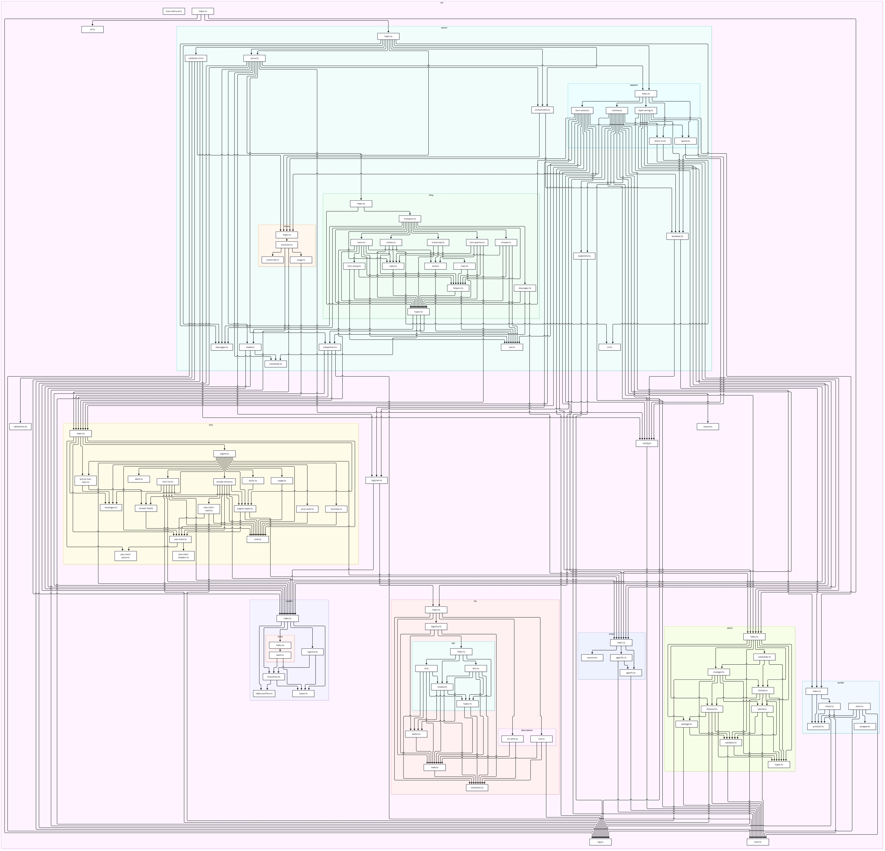

# yog

An agent harness that mounts a virtual FUSE directory and runs a streaming
OpenAI-compatible chat completion with a single tool: `bash`. System
features are presented to agents as proxied virtual file descriptors.

## Documentation

The docs live in `docs/`, one document per concern:

- [Contract](docs/contract.md): the v1 HTTP/SSE wire contract. Routes,
  message types, stream events, aborts, rate limits, disconnects, and
  session dormancy.
- [Operations](docs/operations.md): running the daemon. CLI,
  configuration, Docker, state on disk, and environment requirements.
- [Harness](docs/harness.md): what agents get. The virtual
  filesystem, the bash tool, skills, state, and token accounting.
- [Token accuracy](docs/token-accuracy.md): the plan and incident analysis
  behind the token estimator and `yog calibrate`.

The daemon is reached by clients at its origin (default
`http://127.0.0.1:8111`; the TUI's `serverUrl`). One-shot client turns are
handled by the [yog-client-tui](https://github.com/haliphax-ai/yog-client-tui)
application, which speaks the v1 contract directly.

## File map

```
src/
  index.ts          CLI entry: serve, skills, calibrate.
  cli.ts            Argument parsing for the serve subcommand.
  config.ts         Runtime configuration: zod schema, JSON file loader,
                    resolution (defaults <- file <- injection).
  register.ts       The wiring manifest: model-facing tools and virtual
                    filesystem descriptors as module-level constants.
  turn/             The turn engine domain: the barrel (index.ts) streams
                    completions, executes tool calls, feeds results back
                    until the model answers without tools.
  server/           The long-lived HTTP/SSE daemon: composition root
                    (serve.ts), the HTTP/SSE adapter domain (server/http/),
                    SSE framing, session orchestrator, worker pool, the
                    sqlite session store domain (server/store/), the
                    daemon assembly (server/daemon/), compaction, /shake,
                    the agent-CLI registry, and the models.dev cache.
  mount.ts          Mount/unmount helpers (accepts any FuseOps).
  host.ts           Host proxy: the only sanctioned path for descriptors
                    and tools to touch the host filesystem and subprocesses
                    (direct node:fs / node:child_process imports elsewhere
                    are blocked by dependency-cruiser).
  calibration.ts    Offline token-profile fitting (pure; pinned by tests).
  log.ts            pino loggers (server to stdout, client to stderr).
  fuse-native.d.ts  Ambient typings for the untyped fuse-native package.
  vfs/              Descriptor plumbing: the node model, capability flags,
                    the registry (the sole permission guard; it composes
                    the vfs/ops/ FUSE-op modules), and the list + /bin/yog
                    shim descriptors.
  toolkit/          Harness-tool plumbing: ToolSpec/ToolResult, the tool
                    registry, the bash tool (toolkit/tools/), output
                    truncation, token estimation profiles, and the
                    detach seam (module-level background-job policy).
  worker/           The bash worker process: JSONL protocol (bash.run /
                    bash.abort / bash.pid), persistent-shell wrapper,
                    daemon-side client.
  state/            The agentfs-backed state layer (the only module allowed
                    to import the agentfs SDK), session id generation, and
                    the per-call scratch shell-state dirs (runs/).
  skills/           The agent-skills subsystem: frontmatter parsing,
                    discovery, load/unload, PATH injection, agent-CLI
                    commands.
  schedule/         Cancelable-timeout primitive with an injectable clock +
                    timer impl (deterministic time under test; absolute
                    leaf domain).
test/               Unit suites per layer, plus the external-client
                    conformance suites.
docs/               Split documentation; start at docs/README.md.
Dockerfile          Container image: node:24, daemon + agent users, the
                    fuse/CLI packages, tini init.
docker-compose.yml  Runs the daemon with FUSE and seccomp; publishes 8111.
seccomp/            The custom seccomp profile (default + mount/umount2).
```

## Dependency graph

<details><summary>Dependency graph</summary><br />


</details>

Regenerate the Mermaid source with `npm run depcruise:graph`; the image is
maintained on the `assets` branch.
